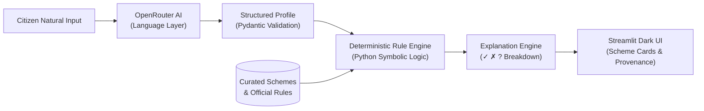

# SchemeSathi 🇮🇳
> **Transparent AI-Powered Government Scheme Navigator**  
> *Hacktoberfest Open-Source AI Challenge MVP*

[](https://www.python.org/)
[](LICENSE)
[](#core-architecture-why-the-llm-never-decides-eligibility)
[](#testing)

---

## The Problem
India administers hundreds of central and state citizen welfare schemes, providing hundreds of billions of rupees in financial, agricultural, educational, and healthcare assistance. Yet, millions of eligible citizens miss out because:
1. **Complex Statutory Criteria**: Eligibility requirements are buried in dense legal notifications.
2. **Opaque "Black-Box" AI**: Citizens are increasingly fed arbitrary scores (e.g. "92% match") without understanding *why* they qualify or fail.
3. **Missing Data Deadlocks**: Real citizens rarely provide all necessary parameters upfront, causing typical search tools to silently discard eligible programs.

## The Solution
**SchemeSathi** is a transparent, privacy-first government scheme navigator that converts a citizen's natural-language situation into a verified structured profile, evaluates that profile against curated statutory eligibility rules using **deterministic Python software**, and clearly explains criterion-by-criterion why schemes apply or do not apply.

> **Core Principle**: Use AI for language understanding; use deterministic software for eligibility logic. The LLM must **never** be the final eligibility decision-maker.

---

## Key Features

- 🌐 **Regional Language Understanding (Punjab & North India)**: Directly understands conversational citizen input in **English, Punjabi (ਪੰਜਾਬੀ), and Hindi (हिंदी)**, as well as transliterated Roman script (e.g., Roman Punjabi, Hinglish), accurately normalizing regional terminology, currency units (e.g., 2 ਲੱਖ / 2 लाख $\rightarrow$ 200000), and occupations (ਕਿਸਾਨ / किसान $\rightarrow$ farmer) into verified profile schemas.
- 📄 **Printable CSC Verification PDF Checklist**: Citizens can download a tailored, printable PDF docket formatted specifically for visits to local **Common Service Centers (CSCs) / Citizen Seva Kendras**, featuring exact required document checklists with physical checkbox squares (`[  ]`), application instructions, and official portal URLs.
- 🧠 **Conversational Language Extraction**: Accepts natural-language statements (*"ਮੈਂ ਪੰਜਾਬ ਤੋਂ 42 ਸਾਲਾਂ ਦਾ ਕਿਸਾਨ ਹਾਂ ਅਤੇ ਮੇਰੀ ਸਾਲਾਨਾ ਆਮਦਨ 2 ਲੱਖ ਰੁਪਏ ਹੈ"*) and extracts entities with Pydantic validation.
- ⚙️ **Deterministic Rule Engine**: Completely auditable symbolic rules (`equals`, `in`, `greater_than_or_equal`, `less_than_or_equal`). Zero probabilistic hallucination on statutory benefits.
- 🔍 **Transparent Criterion Breakdown**: Every scheme card clearly displays:
  - `✓ MATCHED`: Explicit statutory criteria satisfied with user values.
  - `✗ FAILED`: Concrete reasons why a scheme does not apply.
  - `? UNKNOWN`: Missing disclosures that prevent a final determination.
- 💬 **Proactive Missing-Information Detection**: Detects information gaps that block eligibility and prompts the citizen with focused, targeted follow-ups rather than long questionnaires.
- 🏛️ **Verifiable Government Provenance**: Every scheme links directly to its official administering ministry portal (e.g., `pmkisan.gov.in`, `nsap.nic.in`, `scholarships.gov.in`).
- 🎨 **Modern Dark Aesthetic**: Visual design inspired by IndiaAI and AI Kosh — clean typography, subtle borders, restrained accents, and professional card layouts.
- 🛡️ **Privacy-Conscious & Zero Permanent Storage**: Operates entirely in-memory with provider abstraction ready for future on-device local inference.

---

## Core Architecture: Why the LLM Never Decides Eligibility



1. **Language Understanding (LLM)**: Translates colloquial Indian citizen phrasing into a structured `CitizenProfile`. Missing attributes remain strictly `None`.
2. **Eligibility Logic (Python)**: Mathematical and logical verification against statutory scheme definitions. No prompt injection or model hallucination can cause incorrect eligibility grants.
3. **Provider Abstraction**: Interacts with OpenRouter through `LLMService`. This ensures that local inference (e.g., ONNX, Ollama, vLLM) can be plugged in without changing downstream business logic.

---

## Project Structure
```text
schemesathi/
├── app/
│   ├── api.py               # FastAPI server (React UI + REST endpoints)
│   ├── main.py              # Streamlit application entry point (secondary UI)
│   ├── config.py            # Central environment & path configuration
│   ├── models/              # Pydantic data schemas
│   │   ├── profile.py       # CitizenProfile model & normalizers
│   │   ├── scheme.py        # Scheme & EligibilityRule models
│   │   └── result.py        # EvaluationResult & CriterionResult models
│   ├── services/            # Business & orchestration services
│   │   ├── llm_service.py   # OpenRouter provider & JSON extraction
│   │   ├── profile_service.py # Profile extraction & incremental merging
│   │   ├── eligibility_service.py # Deterministic rule evaluator
│   │   ├── scheme_service.py # Navigator service
│   │   ├── explanation_service.py # Transparent citizen explanations
│   │   └── export_service.py # CSC printable PDF & docket generator
│   └── data/
│       └── scheme_repository.py # Schemes loader & filtering
├── frontend/                # Sarvam AI / AI-For-All inspired React + Vite UI
│   ├── src/
│   ├── dist/                # Pre-built production assets served by FastAPI
│   └── package.json
├── notebooks/               # Comprehensive experimental notebooks
│   ├── 01_environment_setup.ipynb
│   ├── 02_scheme_data_exploration.ipynb
│   ├── 03_openrouter_experiments.ipynb
│   ├── 04_profile_extraction.ipynb
│   ├── 05_eligibility_engine.ipynb
│   └── 06_end_to_end_demo.ipynb
├── data/
│   ├── schemes.json         # Curated schemes with statutory provenance
│   └── README.md            # Data curation & verification policy
├── tests/                   # Offline test suite (29 tests)
│   ├── test_profile.py
│   ├── test_eligibility.py
│   ├── test_schemes.py
│   └── test_llm_service.py
├── docs/
│   └── architecture.md      # Detailed system architecture & sequence flows
├── .env.example             # Example environment file
├── .gitignore               # Strict exclusion of secrets, caches, and env
├── requirements.txt         # Project dependencies
├── ENVIRONMENT.md           # Environment & setup specifications
└── LICENSE                  # MIT Open Source License
```

---

## Quickstart Guide

### 1. Prerequisites
- Python 3.11+
- Git

### 2. Clone Repository & Setup Environment
```bash
git clone https://github.com/your-username/schemesathi.git
cd schemesathi

# Create virtual environment
python -m venv .venv

# On Linux/macOS:
source .venv/bin/activate
# On Windows:
.venv\Scripts\activate

# Install dependencies
pip install -r requirements.txt
```

### 3. Configure OpenRouter API Key
Copy `.env.example` to `.env` and insert your key:
```bash
cp .env.example .env
```
In `.env`:
```env
OPENROUTER_API_KEY=your_key_here
OPENROUTER_MODEL=meta-llama/llama-3.3-70b-instruct
OPENROUTER_BASE_URL=https://openrouter.ai/api/v1
```
*(You can also set or change your API key directly within the web UI sidebar at runtime)*

### 4. Launch the Web Application

#### Option A: Modern React Frontend (FastAPI + Sarvam AI Dark Glassmorphism)
Run the unified FastAPI server which directly serves the pre-built React app and all API endpoints:
```bash
uvicorn app.api:app --host 0.0.0.0 --port 8000
```
Open your browser at **`http://localhost:8000`**.

*(For frontend developers making UI edits)*:
```bash
# Terminal 1: Backend API
uvicorn app.api:app --port 8000 --reload

# Terminal 2: React Vite Dev Server
cd frontend
npm install
npm run dev
```

#### Option B: Streamlit Minimal UI
```bash
streamlit run app/main.py
```
Open `http://localhost:8501`.

---

## Running Notebooks
Launch Jupyter to explore the 6 educational notebooks:
```powershell
conda run -p "Environment_Folder\.conda" jupyter lab
```
Available Notebooks:
1. `01_environment_setup.ipynb` — Environment inspection, paths, and local caches.
2. `02_scheme_data_exploration.ipynb` — Pandas breakdown of scheme categories & rules.
3. `03_openrouter_experiments.ipynb` — OpenRouter provider safety & JSON cleaning.
4. `04_profile_extraction.ipynb` — Natural language to Pydantic profile extraction.
5. `05_eligibility_engine.ipynb` — Pure Python deterministic rule evaluation.
6. `06_end_to_end_demo.ipynb` — End-to-end multi-scenario hackathon demonstration.

---

## Testing
The complete test suite runs 100% offline without requiring an active OpenRouter API key:
```powershell
conda run -p "Environment_Folder\.conda" pytest
```
Output:
```text
============================= 22 passed in 0.58s ==============================
```

---

## Demo Scenarios

| Scenario | Input Prompt | Expected Standing |
|---|---|---|
| **🌾 Scenario 1: Punjab Farmer** | *"I'm a 42-year-old farmer from Punjab with an annual family income of ₹2 lakh."* | **Likely Eligible**: PM-KISAN, Punjab Crop Loan Waiver |
| **🎓 Scenario 2: Student** | *"I'm a student looking for financial assistance for education. Family income is ₹1.5 lakh."* | **Likely Eligible**: Post-Matric Scholarship Scheme |
| **👵 Scenario 3: Senior Citizen** | *"I'm an elderly person (68 years old) living in a rural area with annual income ₹80,000."* | **Likely Eligible**: Indira Gandhi National Old Age Pension |

---

## Privacy Policy
- **No Telemetry**: No user analytics or telemetry packages are bundled.
- **In-Memory Operation**: User inputs and citizen profiles exist strictly in transient memory.
- **Transparent LLM Transmission**: User query text is forwarded only to the user-configured OpenRouter endpoint for entity extraction.

---

## Disclaimer
SchemeSathi provides navigational guidance based on publicly available statutory criteria. It does not provide legal advice or guarantee scheme disbursements. Official scheme eligibility must always be verified and confirmed by the respective administering government authority.

---

## License
Distributed under the MIT License. See [LICENSE](LICENSE) for details.

