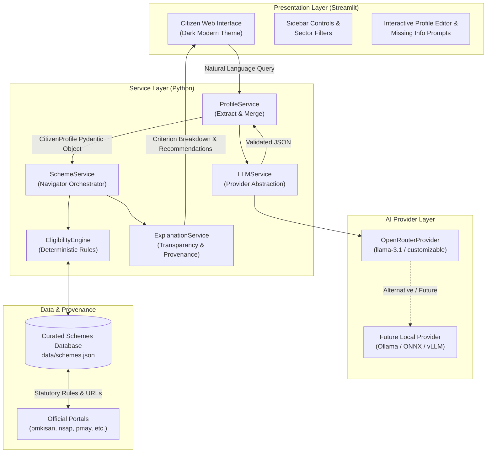
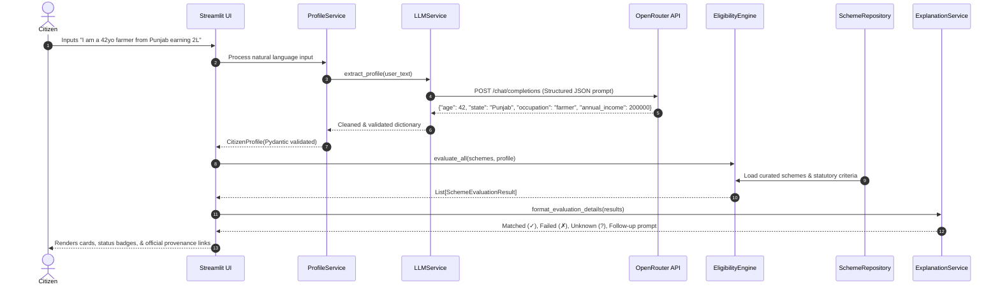
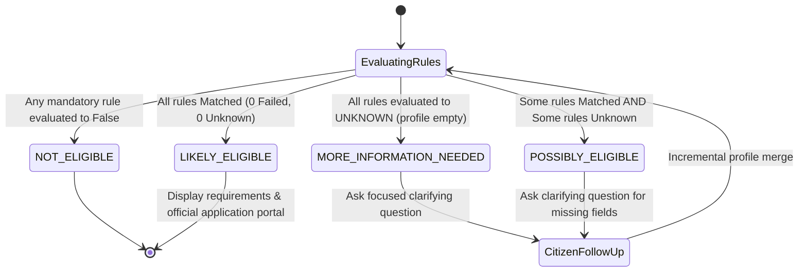

# System Architecture — SchemeSathi

## 1. Architectural Philosophy: Neuro-Symbolic Separation

A core tenet of **SchemeSathi** is the strict boundary between statistical natural language understanding and deterministic software logic:

$$\text{Citizen Request} \xrightarrow{\text{LLM Language Layer}} \text{Structured Profile} \xrightarrow{\text{Deterministic Rule Engine}} \text{Auditable Results}$$

- **Large Language Models (LLM Layer)**: Responsible exclusively for parsing unconstrained conversational input, extracting entities (age, occupation, income, location), and normalizing colloquial phrasing. The LLM is **never** permitted to make the final eligibility determination.
- **Deterministic Python Engine (Symbolic Layer)**: Evaluates the verified profile against statutory scheme criteria using Boolean and relational algebra (`equals`, `less_than_or_equal`, `greater_than_or_equal`, `in`). Every evaluation yields an auditable evidence chain: `MATCHED (✓)`, `FAILED (✗)`, or `UNKNOWN (?)`.

---

## 2. Component Diagram

---

## 3. Sequence Flow

---

## 4. Evaluation State Machine

---

## 5. Security and Privacy Principles

1. **Zero Data Retention**: SchemeSathi operates in-memory; user conversations and extracted citizen profiles are neither logged to persistent databases nor transmitted to third-party telemetry.
2. **Provider Agnostic**: OpenRouter is utilized exclusively through an abstract interface (`OpenRouterProvider`). Swapping to local or air-gapped inference requires zero modifications to business or presentation logic.
3. **Statutory Truth**: Scheme eligibility criteria and document lists are manually audited against official gazettes rather than dynamically hallucinated.

